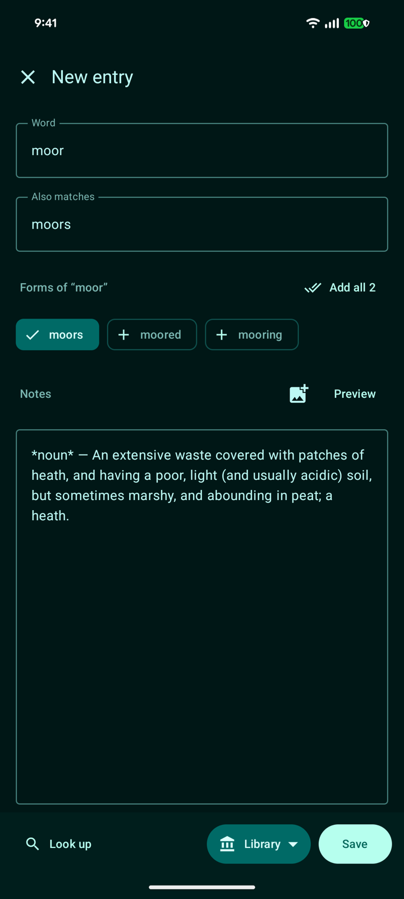
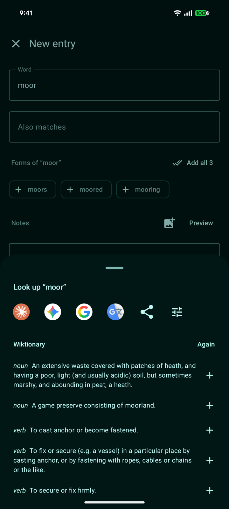
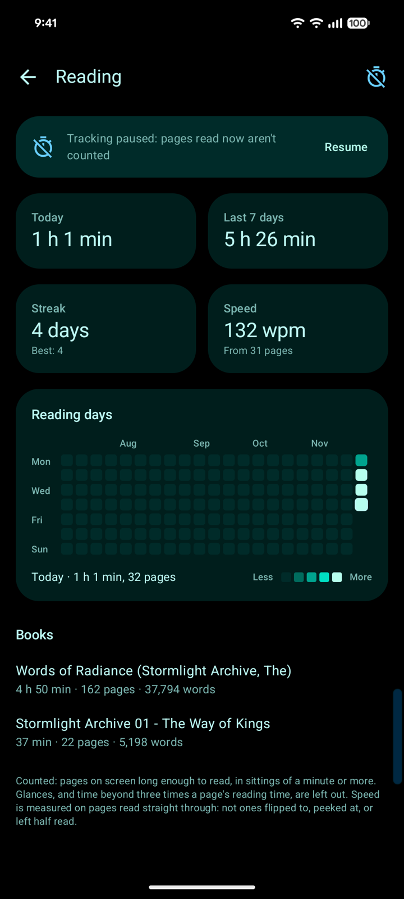

# Poth


A personal EPUB reader for Android (Kotlin, Jetpack Compose, Material 3 Expressive), for
Android 13 and later.

<table>
  <tr>
    <td></td>
    <td></td>
    <td></td>
  </tr>
  <tr>
    <td>Words with entries are underlined; general words more faintly</td>
    <td>An entry's notes, with a link to another entry</td>
    <td>Hold a word to add it, copy it or look it up</td>
  </tr>
  <tr>
    <td></td>
    <td></td>
    <td></td>
  </tr>
  <tr>
    <td>A word's forms, each checked against Wiktionary</td>
    <td>Quick actions and Wiktionary definitions</td>
    <td>Reading stats and reading days</td>
  </tr>
</table>

The pages shown are from *The Hound of the Baskervilles* (public domain), as published by
[Standard Ebooks](https://standardebooks.org).

## Features

### Personal dictionary

- Write entries for names and words as you read, in Markdown. Every place an entry's word
  appears gets a dotted underline, and tapping one opens the entry.
- An entry can be for one book, every book on a shelf (a series), or every book (general words).
- Alternate spellings and names also match, possessives (Kholin's) match on their own, and the
  word's forms (plurals, -ed, -ing) are suggested, with counts from the book. General words can
  add every form at once; each form is checked against Wiktionary before it's offered.
- `[[Links]]` between entries, suggested as you type and followed from the entry card.
- Quick actions send a word, or a prompt made from it, to other apps (search, translation,
  AI assistants).
- Wiktionary definitions, added to the notes with a tap. Only the word is sent.

### Reading stats

- Stats count only real reading: quick glances and pages left open don't count, and rules apply
  when the stats are shown, so changing a rule changes every past day too.
- Reading speed measured from pages read straight through, and measured again on request.
- A GitHub-style calendar of reading days, streaks, and time per book.
- Tracking can be paused, for skimming or showing someone the app.
- Two home-screen widgets: a calendar of reading days, and today's minutes with the last 7 days
  as bars.

## Build and install

```sh
export JAVA_HOME=~/.sdkman/candidates/java/current
./gradlew :app:testDebugUnitTest          # unit tests (plain JVM)
./gradlew :app:installDebug               # build and install on the phone connected over adb
adb shell am start -n dev.indrajith.poth/.MainActivity
```

## Layout

- `epub/`: reading EPUB files: container, OPF (metadata, manifest, spine), and each chapter's
  XHTML and CSS into blocks of styled text (`ChapterParser`). Plain Kotlin, tested on the JVM.
- `reader/`: laying chapters out in pages with Android's `StaticLayout` (`Paginator`), the open
  book and its page cache (`OpenBook`, `Pages`), and timing pages on screen (`PageClock`).
- `data/`: the SQLite database (`PothDatabase`), books and reading positions, the page-view log,
  importing a picked file.
- `dictionary/`: matching dictionary terms in text, guessing a new entry's scope, and the small
  Markdown subset entries are written in. Plain Kotlin, tested on the JVM.
- `actions/`: quick actions, handing a word (filled into a template) to other apps.
- `stats/`: what counts as reading, worked out from the raw page views. Plain Kotlin, tested.
- `widget/`: the home-screen widgets (Glance): reading days, its calendar drawn at the widget's
  exact size, and today's reading.
- `ui/`: Compose screens: the book list, the reader, and the dictionary card and editor.

A reading position is a spine index and a character offset in that chapter's text, so it does not
change with the font size or the screen. Changing how chapters are parsed can shift offsets a little.

Books are copied into the app's storage when added and named by their SHA-256, which is also the
book's ID: the same file added twice is one book.

## Plan

Built in iterations; each one ends with something usable on the phone.

- [x] 0. Skeleton: database (books, shelves, page views), add an EPUB, see its text
- [x] 1. Reader core: own page renderer, swipe to turn, position remembered, page views logged
- [x] 2. Reader bars: title/section/page, "18 of 1789", part ticks, safe scrubber, contents
- [x] 3. Pinch zoom (magnify without reflow)
- [x] 4. Dictionary: Markdown entries, Book/Shelf/Library scopes, underlines
- [x] 5. Quick actions: look a word up in installed apps, prompt templates; Wiktionary definitions
- [x] 6. Reading stats (weighted at query time; quick glances don't count), GitHub-style calendar, home-screen widget
- [x] Library: covers, shelves, progress per book, today's reading at the top
- [x] Whole dictionary: every entry by place, search, [[links]] suggested while writing
- [ ] 7. Polish: search, font settings, `.md` export, backup
- [x] Pictures in entries, and copied from books
- Later: where each edit was made
